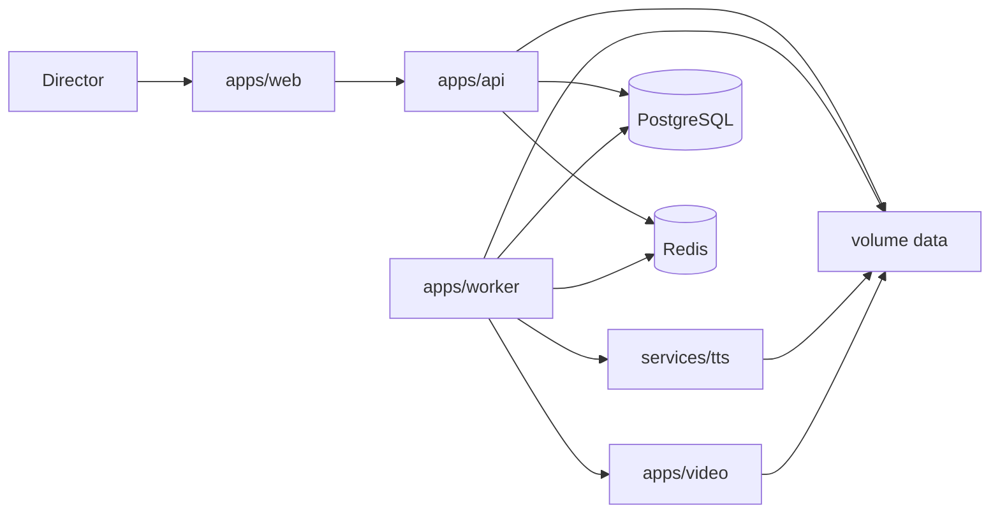

# Kiến trúc hệ thống

Các quyết định gốc nằm ở [decisions/](decisions/). Tài liệu này mô tả các process và đường đi của dữ liệu.

## Process

| Process | Trách nhiệm |
|---|---|
| `apps/web` | React 19, Vite, Tailwind CSS v4, shadcn/ui, Zustand, TanStack Query, React Three Fiber 9, Drei 10. |
| `apps/api` | Fastify 5. Session, CRUD, approval, SSE. Không render video. |
| `apps/worker` | Ba queue BullMQ: `llm`, `media`, `render`. State machine và gọi provider. |
| `apps/video` | Composition Remotion và `renderMedia()`. Package riêng, template 2D. |
| `services/tts` | FastAPI nội bộ: `POST /synthesize`, `POST /align`. Bọc VieNeu-TTS v3 Turbo. |
| PostgreSQL 17 | Project, version, approval, job, event, usage. |
| Redis 7 | Queue và khóa idempotency ngắn hạn. |
| Volume `data/` | Upload, WAV, MP4, JSON lớn. DB lưu `storage_key` tương đối. |

Node image của Phase 0 là `node:24`. `api` và `worker` là hai lệnh của cùng codebase. TTS chỉ mở trên Docker network nội bộ. API local bind `127.0.0.1`.

## Package dùng chung

| Package | Việc |
|---|---|
| `packages/contracts` | Zod 4.2+, import `zod/v4`. Schema là hợp đồng giữa API, worker và CLI. |
| `packages/db` | Drizzle schema, migration, query. |
| `packages/config` | Đọc environment một lần và dừng process nếu thiếu biến bắt buộc. |

`services/tts` là project Python, không nằm trong pnpm workspace.

## Luồng một video

1. API ghi brief và tạo `workflow_run`.
2. Worker enqueue job. Payload job là ID, không nhét full prompt vào Redis.
3. Worker đọc artifact cha từ DB và đĩa, gọi đúng một năng lực (LLM, TTS, align hoặc render), validate, ghi artifact mới và event.
4. API phát SSE từ hàng `events` và từ `QueueEvents` cho bản ghi đang chạy.
5. Cổng `script` và `final` dừng workflow cho đến khi API nhận decision của Director.

Schema bảng nằm ở [03-DATABASE-DESIGN.md](03-DATABASE-DESIGN.md). Trạng thái hợp lệ nằm ở [04-AGENT-ORCHESTRATION.md](04-AGENT-ORCHESTRATION.md). Props video nằm ở [05-VIDEO-PIPELINE.md](05-VIDEO-PIPELINE.md).

## Bộ nhớ và hàng đợi

Mất dữ liệu Redis không xóa lịch sử. Lúc khởi động, worker đối chiếu bảng `jobs` và tạo lại job còn `queued` hoặc `running` mà chưa có artifact hoàn tất. Event đã commit vẫn đọc được theo `events.id`.

## Phiên bản đã kiểm tra lúc chốt kế hoạch

Các mốc sau lấy từ tài liệu chính thức ngày 27/10/2026. Bản pin cụ thể được ghi lúc `pnpm install` và trong báo cáo Phase 0.

- Fastify 5.5+ với `@fastify/type-provider-zod` và Zod 4.2+.
- `@react-three/fiber` 9 với React 19. `@react-three/drei` 10. Fiber 10 còn alpha, không dùng.
- Remotion hỗ trợ React 19 trên dòng 4.x. Major version và yêu cầu `licenseKey` được chốt ở `P0-05`.
- VieNeu open-source dùng cho MVP là v3 Turbo, Apache-2.0, preset voice. v4 không nằm trong image local.
