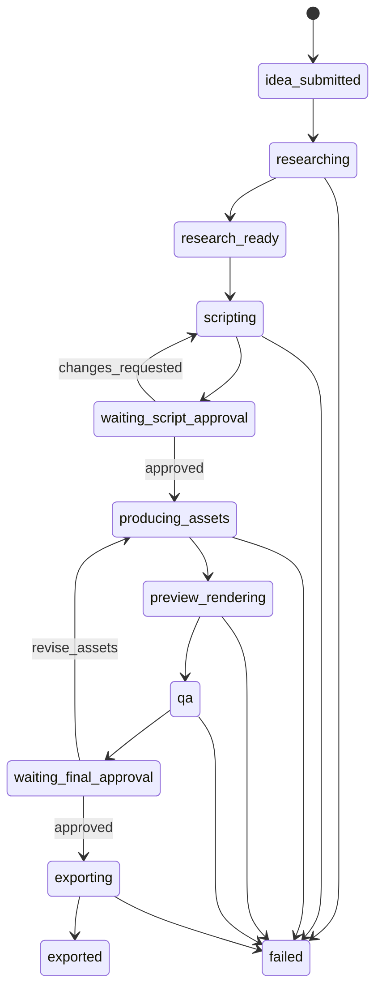

# Điều phối Agent

Vai trò là loại việc và nhãn hiển thị. Process thực thi là worker BullMQ. Không có bảy vòng hội thoại LLM.

Schema bảng nằm ở [03-DATABASE-DESIGN.md](03-DATABASE-DESIGN.md). Hợp đồng hình và tiếng nằm ở [05-VIDEO-PIPELINE.md](05-VIDEO-PIPELINE.md).

## Vai trò

| Vai trò | Queue | Việc |
|---|---|---|
| `producer` | không gọi LLM ở MVP | Code chọn job kế tiếp và cổng duyệt. |
| `research` | `llm` | Tóm tắt nguồn Director đưa và URL được phép. |
| `script` | `llm` | Hai phương án kịch bản trong một response. |
| `visual` | `llm` | Storyboard từ script đã duyệt. |
| `voice` | `media` | TTS rồi alignment. Code, không phải LLM. |
| `video` | `render` | Ghép `render_props`, preview, export. |
| `qa` | `media` hoặc trong worker | Kiểm tra schema, file, ffprobe, caption. LLM QA tắt mặc định. |

Concurrency: mỗi queue là 1. Timeout mặc định: LLM 90 giây, fetch 15 giây, TTS 5 phút, alignment 5 phút, preview 10 phút, export 20 phút.

Trần gọi LLM: 6 lần cho một vòng tới export, cộng 2 lần cho mỗi lượt Director yêu cầu sửa. Hết trần thì `failed` với `failure_code = cost_ceiling`. Sửa phụ đề và render lại không tính vào trần này.

## Trạng thái workflow

`rejected` là decision lưu trong `approvals`, workflow vẫn đứng ở cổng tương ứng.

Transition hợp lệ chỉ là các cạnh trên, cộng hai nhóm sau. Mọi cạnh khác trả `invalid_transition`.

`cancelled` đến được từ mọi trạng thái trừ `exported` và `cancelled`. Hủy không tạo approval.

Từ `failed`, resume đi tới đúng `resume_from`. Giá trị hợp lệ: `researching`, `scripting`, `producing_assets`, `preview_rendering`, `qa`, `exporting`. `exported` và `cancelled` không có resume.

`waiting_approval` trên `agent_runs` chỉ dùng cho `script` khi đang `waiting_script_approval`, và cho `producer` khi đang `waiting_final_approval`.

## Artifact nghiên cứu

`P3-03` triển khai schema này trong `packages/contracts`.

`fetch_log.requests[]`: `url`, `finalUrl`, `status`, `contentHash`.

`research`:

- `schemaVersion`: `1`
- `summary`: string
- `facts[]`: `statement`, `claimStatus` (`verified`, `assumption`, `user_provided`), `sourceIds[]`
- `sources[]`: `id`, `title`, `origin` (`user_reference`, `fetched_url`), `url` tùy chọn

Fact `verified` phải trỏ tới source tồn tại. Source `fetched_url` phải khớp một dòng trong `fetch_log`. Fact không có source bị validator từ chối. Prompt của model nhận nguồn trong khối dữ liệu không tin cậy.

Google Search grounding không dùng ở MVP.

## Job và retry

Payload Redis: `{ jobId }`. Worker tải dữ liệu từ PostgreSQL.

BullMQ thử lại lỗi mạng và lỗi process tới `max_attempts = 2`. Lỗi Zod được một lần gọi repair kèm thông báo validate, rồi `failed` nếu vẫn sai. Không repair bằng cách nới schema.

Nếu artifact cùng `idempotency_key` đã `completed`, lần chạy sau trả artifact đó và không gọi provider.

Hủy đặt job và agent liên quan sang `cancelled`, ghi event, và không tạo approval.

## Làm bẩn version

| Thay đổi | Artifact bị bỏ qua ở lần dựng tiếp |
|---|---|
| Research mới | Không hủy script đã duyệt. Workflow gắn cờ đọc được `research_stale` trong metadata của run. |
| Script mới đã duyệt | storyboard, audio, alignment, captions, render props, preview, QA, export của script cũ |
| Audio mới | alignment, captions, render props, preview, QA, export |
| `caption_override` | render props, preview, QA, export. WAV giữ nguyên |
| Storyboard mới | render props, preview, QA, export. Audio giữ nguyên nếu narration không đổi |

Cờ bẩn là hệ quả của `artifact_dependencies`, không phải xóa file cũ. File cũ vẫn phục vụ version đã duyệt.

Resume đọc `resume_from` và artifact còn hợp lệ. Ví dụ TTS đã xong thì resume lúc render không gọi lại TTS.

## Approval

Cùng transaction: insert `approvals`, đổi `workflow_runs.status`, insert `events`.

`changes_requested` ở cổng script chuyển sang `scripting` với ghi chú Director trong input của lần gọi sau. `approved` ở cổng script chuyển sang `producing_assets`. `approved` ở cổng final chỉ cho phép export đúng `artifact_id` đã ghi. Export một preview khác là `approval_required`.
