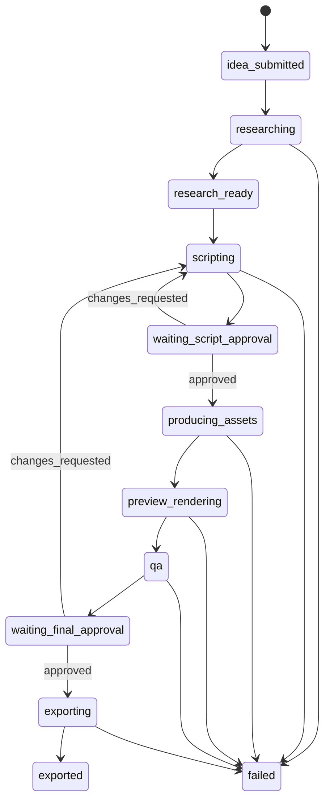

# Điều phối Agent

Vai trò là loại việc và nhãn hiển thị. Process thực thi là worker BullMQ. Không có bảy vòng hội thoại LLM.

Schema bảng nằm ở [03-DATABASE-DESIGN.md](03-DATABASE-DESIGN.md). Hợp đồng hình và tiếng nằm ở [05-VIDEO-PIPELINE.md](05-VIDEO-PIPELINE.md).

## Vai trò

| Vai trò | Queue | Việc |
|---|---|---|
| `producer` | không gọi LLM ở MVP | Code chọn job kế tiếp và cổng duyệt. |
| `research` | `llm` | Tóm tắt nguồn Director đưa và URL được phép. |
| `script` | `llm` | Hai phương án kịch bản trong một response. Từ Phase 6, mỗi phương án kèm shot list (ADR-014). |
| `visual` | `llm`; `render` từ Phase 6 | Storyboard từ script đã duyệt. Từ Phase 6: dựng storyboard từ shot list bằng code và render ảnh tĩnh trước cổng script, không gọi LLM. |
| `voice` | `media` | TTS rồi alignment. Code, không phải LLM. Từ Phase 6: đọc theo câu với giọng của người nói, căn chữ một lần cho cả cảnh (ADR-015). |
| `video` | `render` | Ghép `render_props`, preview, export. |
| `qa` | `media` hoặc trong worker | Kiểm tra schema, file, ffprobe, caption. LLM QA tắt mặc định. |

Concurrency: mỗi queue là 1. Timeout mặc định: LLM 90 giây, fetch 15 giây, TTS không giới hạn (P3-17, Director 2026-11-01; đặt `TTS_TIMEOUT_MS` nếu muốn giới hạn). Job voice và render ghi `job.progress` bằng số đếm thật (bước cảnh, frame) và dừng ở bước kế tiếp khi run bị hủy, alignment 5 phút, preview 10 phút, export 20 phút.

Trần gọi LLM: 6 lần cho một vòng tới export, cộng 2 lần cho mỗi lượt Director yêu cầu sửa. Hết trần thì `failed` với `failure_code = cost_ceiling`. Sửa phụ đề và render lại không tính vào trần này.

## Trạng thái workflow

Phase 6 thêm trạng thái `storyboarding` giữa `scripting` và `waiting_script_approval` cho script `2` có shot list ([ADR-014](decisions/ADR-014-motion-kit-and-shot-list.md)); xem mục "Phase 6" dưới sơ đồ.

`rejected` là decision lưu trong `approvals`, workflow vẫn đứng ở cổng tương ứng.

Transition hợp lệ chỉ là các cạnh trên, cộng hai nhóm sau. Mọi cạnh khác trả `invalid_transition`.

`cancelled` đến được từ mọi trạng thái trừ `exported` và `cancelled`. Hủy không tạo approval.

Từ `failed`, resume đi tới đúng `resume_from`. Giá trị hợp lệ: `researching`, `scripting`, `producing_assets`, `preview_rendering`, `qa`, `exporting`. `exported` và `cancelled` không có resume.

### Phase 6

Cạnh thêm (P6-10 sửa state machine trong contracts và `packages/db/src/workflow.ts`):

- `scripting → storyboarding`: script job ghi artifact script `2` có shot list.
  - Mọi gói viết script `2`; script `1` và `EduVertical` đã xóa (ADR-013 bổ sung (2) 2026-11-03). Brief dùng gói không còn (ví dụ `explainer`) thì job script `failed` với `configuration_missing`.
  - Script job tạo job storyboard trong cùng transaction: vai `visual`, queue `render`, key `storyboard:<run>:script:<job script>`.
  - Agent `script` đặt `waiting_approval` ngay khi ghi script `2`, vì kịch bản đã xong và chỉ còn chờ Director; storyboard chỉ thêm ảnh cho màn duyệt.
- `storyboarding → waiting_script_approval`: job storyboard (queue `render`, vai `visual`) đã ghi artifact `storyboard`. Lỗi render ảnh hoặc lỗi kiểm tự động **không** chặn cổng: job vẫn ghi artifact với danh sách lỗi và chuyển trạng thái; hết lượt retry cũng vậy. Không có cạnh `storyboarding → failed`; hủy vẫn đi `cancelled`.
- `waiting_final_approval → preview_rendering`: chỉ khi run `creative` và Director chọn "Yêu cầu sửa" để dùng tài sản mới đã `approved` cho các yêu cầu của run ([ADR-016](decisions/ADR-016-creative-mode-motion-assets.md), bước 6). Job render dựng lại `render_props` thay tài sản tạm, không gọi LLM, không gọi TTS. Mọi trường hợp "Yêu cầu sửa" khác ở cổng final vẫn đi `scripting` (P3-14). Director xác nhận cạnh này 2026-11-03.

`resume_from` không thêm giá trị: lỗi ngoài ý muốn ở `storyboarding` không xảy ra theo thiết kế trên. Nếu process chết và BullMQ hết lượt, worker vẫn ghi artifact `storyboard` chỉ có `errors[]` và mở cổng script (P6-10).

`waiting_approval` trên `agent_runs` chỉ dùng cho `script` khi đang `storyboarding` hoặc `waiting_script_approval`, và cho `producer` khi đang `waiting_final_approval`.

## Artifact nghiên cứu

`P3-03` triển khai schema này trong `packages/contracts`.

`fetch_log.requests[]`: `url`, `finalUrl`, `status`, `contentHash`.

`research`:

- `schemaVersion`: `1`
- `summary`: string
- `facts[]`: `statement`, `claimStatus` (`verified`, `assumption`, `user_provided`), `sourceIds[]`
- `sources[]`: `id`, `title`, `origin` (`user_reference`, `fetched_url`), `url` tùy chọn

Fact `verified` phải trỏ tới source tồn tại. Source `fetched_url` phải khớp một dòng trong `fetch_log`. Fact không có source bị validator từ chối. Prompt của model nhận nguồn trong khối dữ liệu không tin cậy.

Google Search grounding không dùng ở MVP.

## Job và retry

Payload Redis: `{ jobId }`. Worker tải dữ liệu từ PostgreSQL.

BullMQ thử lại lỗi mạng và lỗi process tới `max_attempts = 2`. Lỗi Zod được một lần gọi repair kèm thông báo validate, rồi `failed` nếu vẫn sai. Không repair bằng cách nới schema.

Research và script gọi Gemini, hoặc Claude Code CLI khi run chọn model `claude-code…` (ADR-007, bổ sung 2026-11-02; P6-15). Hai client dùng chung prompt, schema và repair. Với Claude Code, các lỗi sau `failed` ngay, không retry:

- `configuration_missing`: CLI chưa đăng nhập hoặc không chạy được;
- `quota_exhausted`: hết hạn mức gói Claude. Director bấm Tiếp tục sau khi hạn mức reset.

Shot list gửi Gemini theo cách `flat` của spike [P6-01](spikes/P6-01-shot-list.md): tối đa 2 tầng mảng-chứa-object, `lines[]` và `shots[]` ở cấp phương án gắn `sceneId`, nhân vật là `actor1`/`actor2`/`actor3` (người thứ ba chỉ ở cỡ `wide`, `high`; bổ sung ADR-013 2026-11-03). Không mã hóa danh sách lớn thành chuỗi JSON. Contract nội bộ vẫn lồng nhau; adapter chuyển đổi như `diagramJson`. Mọi lần gọi có trần `maxOutputTokens`.

Prompt kịch bản Phase 6 nhận: gói thể loại (nhịp, nhịp cắt), tính cách, giọng điệu và câu cửa miệng của kênh, danh sách id tài sản `approved` (chế độ `standard`) hoặc thêm hướng dẫn `assetRequests[]` (chế độ `creative`). Vị trí nhân vật trên khung do code quyết định, không do LLM. Vẫn một lần gọi, hai phương án, repair tối đa một lần.

Nếu artifact cùng `idempotency_key` đã `completed`, lần chạy sau trả artifact đó và không gọi provider.

Hủy đặt job và agent liên quan sang `cancelled`, ghi event, và không tạo approval.

## Làm bẩn version

| Thay đổi | Artifact bị bỏ qua ở lần dựng tiếp |
|---|---|
| Research mới | Không hủy script đã duyệt. Workflow gắn cờ đọc được `research_stale` trong metadata của run. |
| Script mới đã duyệt | storyboard, audio, alignment, captions, render props, preview, QA, export của script cũ |
| Audio mới | alignment, captions, render props, preview, QA, export |
| `caption_override` | không còn được tạo (ADR-013 bổ sung (2) 2026-11-03); dòng giữ để đọc run cũ |
| Storyboard mới | render props, preview, QA, export. Audio giữ nguyên nếu narration không đổi |
| Sửa một câu thoại (script `2`) | audio của câu đó, audio ghép và alignment của cảnh chứa câu, captions, render props, preview, QA, export. Câu khác dùng cache TTS |
| Giọng nhân vật trong kênh đổi | audio các câu của nhân vật đó và mọi thứ phụ thuộc |
| Version motion kit hoặc tài sản đổi | render props, storyboard, preview, QA, export (qua `templateVersion`, `content_hash`) |

Cờ bẩn là hệ quả của `artifact_dependencies`, không phải xóa file cũ. File cũ vẫn phục vụ version đã duyệt.

Resume đọc `resume_from` và artifact còn hợp lệ. Ví dụ TTS đã xong thì resume lúc render không gọi lại TTS.

## Approval

Cùng transaction: insert `approvals`, đổi `workflow_runs.status`, insert `events`.

`changes_requested` ở cổng script chuyển sang `scripting` với ghi chú Director trong input của lần gọi sau. `changes_requested` ở cổng final cũng chuyển sang `scripting` (Director chốt 2026-11-01, P3-14): job script viết lại hai phương án theo ghi chú, Director duyệt lại kịch bản, rồi giọng, hình, render và QA chạy lại; giọng của cảnh không đổi chữ dùng lại cache TTS. Research không chạy lại. `approved` ở cổng script chuyển sang `producing_assets`. `approved` ở cổng final chỉ cho phép export đúng `artifact_id` đã ghi. Export một preview khác là `approval_required`.
