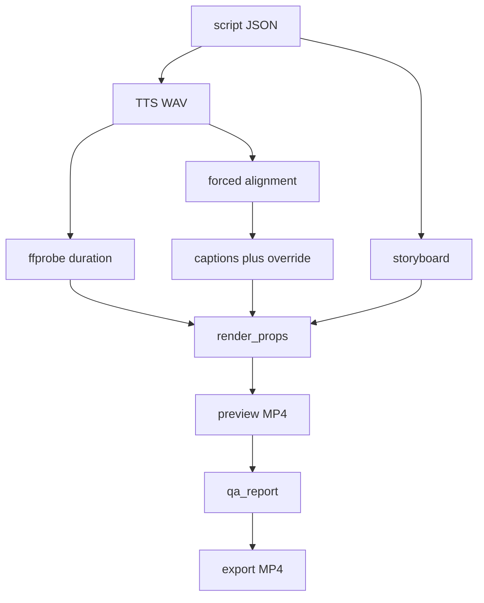

# Pipeline video

Pipeline biến script đã validate thành MP4 dọc. Remotion nhận `render_props` đã tính sẵn. Composition không gọi LLM và không tự đo audio.

## Các bước

Export chỉ bắt đầu sau approval `final` trỏ tới preview đó. Xem [04-AGENT-ORCHESTRATION.md](04-AGENT-ORCHESTRATION.md).

## Script JSON

`P0-02` đặt schema này tại `packages/contracts`, Zod 4.

- `schemaVersion`: `1`
- `language`: `vi`
- `title`: 1–80 ký tự
- `hook`: 1–400 ký tự
- `scenes`: 3–8 phần tử
- `cta`: 1–240 ký tự
- `sources`: mảng, fixture được rỗng; script do LLM sinh phải có ít nhất một source

Mỗi scene:

- `id`: `^[a-z0-9-]{1,40}$`, duy nhất trong file
- `narration`: 1–600 ký tự
- `onScreenText`: 1–120 ký tự
- `visualIntent`: 1–400 ký tự
- `templateSlot`: `title`, `explain`, `code`, `diagram`, `cta`
- `codeSnippet` khi slot là `code`: `language` thuộc `ts`, `sql`, `json`, `bash`, `text`; `code` 1–800 ký tự
- `diagram` khi slot là `diagram`: tối đa 6 `nodes` (`id`, `label`) và 8 `edges` (`from`, `to`, `label` tùy chọn)

Scene đầu có slot `title`. Scene cuối có slot `cta`.

## TTS

`services/tts` nhận `{ text, voiceId }` và trả WAV. Bên trong gọi VieNeu-TTS v3 Turbo, profile CPU/ONNX là mặc định. Facade này là hợp đồng của studio. Client TypeScript không gọi thẳng đường dẫn nội bộ của VieNeu.

Độ dài cảnh bằng duration ffprobe của WAV cảnh đó, cộng 200 ms đầu và 200 ms cuối. Tổng frame bằng tổng duration đã đo tại 30 fps. Không ước lượng bằng số từ.

## Alignment

Endpoint speech của VieNeu trả audio, không trả word timestamp. Studio căn transcript đã biết với WAV.

Thứ tự:

1. Chuẩn hóa số, ngày và từ vay mượn sang dạng nói. Thư viện cụ thể được chọn ở `P0-04` sau khi xem license.
2. Forced alignment giữa dạng nói và WAV. Spike `P0-04`: CTC Việt Nam không đạt cổng trên audio VieNeu; **engine mặc định MVP** là Whisper `base` + `stable-ts`, language `vi`, transcript đã biết — xem [decisions/ADR-011-whisper-alignment-default.md](decisions/ADR-011-whisper-alignment-default.md). CTC giữ như đường thử nghiệm tùy chọn trong cùng service.
3. Map token dạng nói về từ trên kịch bản.
4. Ghi artifact `alignment` gốc, rồi xuất `captions`.

Cổng Go của `P0-04`: trên mẫu thoại giáo dục khoảng 45–60 giây, ít nhất 90% từ nhận timestamp đơn điệu, và tổng khoảng phủ lệch không quá 250 ms so với duration ffprobe. Ngưỡng này là tiêu chí dự án. Kết quả đo ghi trong báo cáo spike, không điền trước.

**Chấp thuận Director (2026-10-28, chỉ Phase 0 spike):** WAV ffprobe **44.000 s** (`5bf561a3048346639aabb497df357d33.wav`) được coi là đủ bằng chứng khả thi số; không yêu cầu synthesize lại để đạt 45.000 s. Không thay thế QA nghe thử hay yêu cầu chất lượng production.

`captions[]` tương thích `@remotion/captions`: `text`, `startMs`, `endMs`, `timestampMs`. Khoảng trắng nằm ở đầu mỗi từ sau từ đầu tiên, vì `createTikTokStyleCaptions()` ngắt trang theo khoảng trắng. Khi render, phần phụ đề dùng `white-space: pre`.

QA alignment báo lỗi nếu thiếu từ, timestamp chồng nhau, hoặc một khoảng trong cùng câu dài hơn 1,5 giây. Confidence thấp là warning.

## Sửa timing

Director sửa trên bản copy. Artifact `caption_override` lưu các từ đã sửa. Render đọc override nếu có, và vẫn giữ alignment gốc. Sửa timing không gọi TTS.

## Storyboard và render props

Storyboard mô tả hình từng `sceneId`: slot, chữ trên màn hình, code hoặc diagram. Nó chưa giữ duration cuối.

`render_props` là input của Remotion:

- `templateId`: `EduVertical`
- `templateVersion`: chuỗi tăng khi đổi composition
- `fps`: `30`
- `width`: `1080`
- `height`: `1920`
- `audio.storageKey`, `audio.durationMs`
- `scenes[]`: `sceneId`, `fromMs`, `durationMs`, slot và nội dung hình
- `captions[]`

`P1-04` dựng template tối, tiếng Việt: trang tiêu đề, trang giải thích, khung code, sơ đồ hộp-mũi tên, trang CTA, phụ đề theo trang với `combineTokensWithinMilliseconds` 1200. Asset bên ngoài chỉ gồm font và icon có tên license trong manifest của package video.

Preview và export dùng cùng props. Export dùng CRF thấp hơn preview; hai mức CRF là hằng số trong config. Cùng `content_hash` của props và cùng `templateVersion` thì tái sử dụng MP4.

## QA trước cổng final

`qa_report.checks[]` có `code`, `severity` (`error`, `warning`), `message`. `passed` là true khi không có error.

Error chặn approval hữu ích: `schema_invalid`, `audio_missing`, `duration_out_of_range`, `caption_gap`, `frame_size_mismatch`.

Warning vẫn cho Director duyệt: `low_alignment_confidence`, `research_stale`, `long_silence`.

QA không ghi approval.
