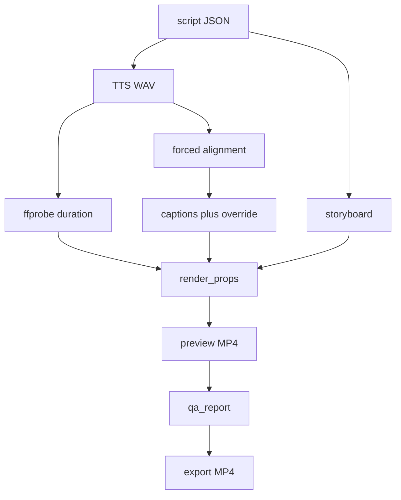

# Pipeline video

Pipeline biến script đã validate thành MP4 dọc. Remotion nhận `render_props` đã tính sẵn. Composition không gọi LLM và không tự đo audio.

## Các bước

Export chỉ bắt đầu sau approval `final` trỏ tới preview đó. Xem [04-AGENT-ORCHESTRATION.md](04-AGENT-ORCHESTRATION.md).

## Script JSON

`P0-02` đặt schema này tại `packages/contracts`, Zod 4.

- `schemaVersion`: `1`
- `language`: `vi`
- `title`: 1–80 ký tự
- `hook`: 1–400 ký tự
- `scenes`: 3–8 phần tử
- `cta`: 1–240 ký tự
- `sources`: mảng, fixture được rỗng; script do LLM sinh phải có ít nhất một source

Mỗi scene:

- `id`: `^[a-z0-9-]{1,40}$`, duy nhất trong file
- `narration`: 1–600 ký tự
- `onScreenText`: 1–120 ký tự
- `visualIntent`: 1–400 ký tự
- `templateSlot`: `title`, `explain`, `code`, `diagram`, `cta`
- `codeSnippet` khi slot là `code`: `language` thuộc `ts`, `sql`, `json`, `bash`, `text`; `code` 1–800 ký tự
- `diagram` khi slot là `diagram`: tối đa 6 `nodes` (`id`, `label`) và 8 `edges` (`from`, `to`, `label` tùy chọn)

Scene đầu có slot `title`. Scene cuối có slot `cta`.

## Script JSON v2 (Phase 6)

`P6-06` đặt schema này trong `packages/contracts`. Nguồn quyết định: [ADR-013](decisions/ADR-013-brand-kit-and-formats.md), [ADR-014](decisions/ADR-014-motion-kit-and-shot-list.md), [ADR-015](decisions/ADR-015-multi-speaker-voice.md), [ADR-016](decisions/ADR-016-creative-mode-motion-assets.md); hình dạng đã thử ở spike [P6-01](spikes/P6-01-shot-list.md).

Schema phụ thuộc kênh và kho tài sản, nên contracts xuất hàm dựng schema `scriptV2Schema({ cast, assetCatalog, format, mode })` thay vì một hằng số. `cast` là `brand_characters` của kênh; `assetCatalog` là các `motion_assets` được phép dùng (chế độ `standard`: chỉ `approved`).

Gốc:

- `schemaVersion`: `2`
- `language`: `vi`
- `formatId`, `formatVersion`: gói thể loại của brief
- `title`: 1–80 ký tự
- `scenes`: 3–8 phần tử
- `sources`: `[{ id, title, url? }]`; bắt buộc ít nhất một source khi gói có nhịp cần nguồn
- `assetRequests`: chỉ có ở chế độ `creative`, 0–5 phần tử (mục Kho tài sản bên dưới)

Mỗi scene:

- `id`: `^[a-z0-9-]{1,40}$`, duy nhất
- `beat`: id một nhịp của gói thể loại. Các nhịp xuất hiện theo thứ tự của gói, mỗi nhịp có ít nhất một cảnh
- `sourceIds[]`: id trong `sources`; không được rỗng khi nhịp có `requiresSource`
- `lines`: 1–6 câu
- `shots`: 1–8 shot
- Không có `board` (code, sơ đồ) và không có chữ phủ màn hình: video `StickStory` chỉ có hoạt hình và phụ đề lời thoại ([ADR-014](decisions/ADR-014-motion-kit-and-shot-list.md), bổ sung 2026-11-03). Ý cần minh họa dùng hành động, biểu cảm, đồ vật, bối cảnh; kho thiếu thì xin tài sản mới ở chế độ `creative`

Mỗi câu (`lines[]`):

- `id`: `^l[0-9]{1,3}$`, duy nhất trong cả script (dùng để sửa câu và cache theo câu)
- `speaker`: `character_key` của nhân vật có `speaks = true` trong kênh, hoặc `narrator` khi gói cho phép (`allowNarrator`). Zod chặn nhân vật có `speaks = false` và key lạ. Từ bổ sung ADR-013 ngày 2026-11-03, Đậu có lời thoại (câu ngắn, không đưa dữ kiện)
- `text`: 1–300 ký tự
- `emotion` tùy chọn: id tài sản kind `expression`; chỉ chọn biểu cảm, không đổi giọng

Mỗi shot (`shots[]`):

- `id`: `^s[0-9]{1,3}$`, duy nhất trong cả script
- `lineId`: câu trong **cùng cảnh** mà cú cắt neo vào
- `cutOnWord`: một từ có trong câu đó (so sau chuẩn hóa giống alignment); cảnh cắt trước từ này 2 frame. Shot đầu của cảnh bắt đầu ở đầu cảnh, nhưng `cutOnWord` vẫn bắt buộc để kiểm
- `background`: id tài sản kind `background`
- `shotSize`: `wide`, `medium`, `close`, `high`
- `camera` tùy chọn: id tài sản kind `camera` (chuyển động máy)
- `focus`: `character_key` của nhân vật được lấy nét
- `actors`: 1–3 phần tử `{ character, action, expression }`; ba người chỉ ở cỡ `wide`, `high`, còn `medium`, `close` tối đa hai (`MAX_ACTORS_BY_SHOT_SIZE`, bổ sung ADR-013 2026-11-03). `character` là `character_key`; `action` là id kind `action` hoặc `pose`; `expression` là id kind `expression`. **Không có vị trí:** code đặt nhân vật trên khung theo luật liền mạch (nhân vật giữ nguyên bên giữa các shot liền nhau của cùng cảnh), theo đề xuất của P6-01
- `props[]` tùy chọn: tối đa 3 id kind `prop`. Không có vị trí: code đặt theo luật ở mục Template `StickStory` (P6-19)
- `illustration` tùy chọn (ADR-014 bổ sung 2026-11-11): `{ style: "bubble" | "board", owner, items }`, `items` là 1–3 id kind `prop`, `owner` là nhân vật trong shot, không ở cỡ `close`. Chỉ hình, không chữ. Vẽ ở nửa trên khung, trên vùng phụ đề.
- `ambience[]` tùy chọn: `vignette`, `dust`, `foreground_blur`, là các yếu tố mức 3 bật theo cảnh ([P6-03](spikes/P6-03-render-cost.md))
- `mood` tùy chọn: tông ánh sáng của shot (`day`, `warm`, `cool`, `night`, `danger`, `wonder`), phủ màu lên bối cảnh và nhân vật; bối cảnh ba lớp trượt lệch theo camera ([ADR-023](decisions/ADR-023-depth-layers-and-scene-lighting.md))
- `effects[]` tùy chọn, tối đa hai: hiệu ứng điểm nhấn `flash`, `impact`, `speed_lines`, `sparkle`, `idea`, `confetti`, neo vào nhân vật được lấy nét ([ADR-025](decisions/ADR-025-acting-effects-camera.md))

Kiểm ngữ nghĩa sau Zod (cùng hàm; lỗi trả kèm đường dẫn để repair):

- mọi `lineId` tồn tại, `cutOnWord` nằm trong câu;
- hai shot liền nhau, kể cả qua ranh giới cảnh, không cùng `shotSize`;
- nhân vật trong `actors` và `focus` thuộc kênh;
- người nói của câu neo có mặt trong `actors` của shot, trừ `narrator`;
- id tài sản không có trong `assetCatalog` bị từ chối ở cả hai chế độ. Ở `creative`, shot dùng `fallbackAssetId` của yêu cầu tương ứng.

**Script `1` đã xóa** (ADR-013 bổ sung (2) 2026-11-03): không còn schema, prompt, template `EduVertical` hay màn sửa P2-12. Mọi run mới viết script `2`.

**Gửi LLM.** Generation schema theo cách `flat` (xem [04-AGENT-ORCHESTRATION.md](04-AGENT-ORCHESTRATION.md)): `scenes[]`, `lines[]`, `shots[]` cùng cấp trong một phương án, gắn `sceneId`; `actors` thành `actor1`, `actor2`, `actor3`. Adapter chuyển về dạng lồng nhau ở trên rồi mới chạy Zod.

## Gói thể loại (Phase 6)

Định nghĩa có version trong `packages/contracts` ([ADR-013](decisions/ADR-013-brand-kit-and-formats.md)). Thêm gói là thêm dữ liệu.

- `id` (`^[a-z0-9_]{1,32}$`), `version` (integer), `displayName`
- `beats[]`: `{ id, label, requiresSource }` theo thứ tự
- `defaultCast[]`: `character_key`
- `allowNarrator`: boolean
- `research`: `required`, `optional` hoặc `off`. Gói `off` không được có nhịp `requiresSource`; contracts kiểm khi định nghĩa gói
- `durationSec`: `{ min, max }`; API kiểm thời lượng brief theo đây
- `pacing`: `{ cutsPerMinute: { min, max }, maxStaticSec, noSameShotSizeInARow: true }`
- `qaRules[]`: mã kiểm QA riêng của gói

Lát cắt đầu:

| Gói | Nhịp | Research | Thời lượng | Nhịp cắt |
|---|---|---|---|---|
| `story` v2 ("Hoạt hình", gói của brief từ 2026-11-09 đến 2026-11-12) | như `story` v1 | `required` vì có nhịp `fact` | 30–180 s | 12–18 cắt/phút, shot dài nhất 5 s; không có người dẫn |
| `story` v4 ("Hoạt hình, có mở và kết", gói của mọi brief mới từ 2026-11-12, [ADR-026](decisions/ADR-026-title-and-follow-outro.md)) | `title` (đọc tiêu đề, hình tượng trưng), năm nhịp của v1, `outro` (ba nhân vật mời theo dõi, code dựng hình) | `required` vì có nhịp `fact` | 30–180 s | như v3 |
| `story` v3 ("Hoạt hình, nhịp nhanh", gói của brief ngày 2026-11-12 trước ADR-026, [ADR-024](decisions/ADR-024-editing-rhythm.md)) | như `story` v1 | `required` vì có nhịp `fact` | 30–180 s | 18–26 cắt/phút, shot dài nhất 3,5 s; shot hai người bị chia thì cắt sang người nghe; không có người dẫn |
| `story` v1 ("Hoạt hình", chỉ để đọc brief và run trước 2026-11-09) | `cold_open`, `premise`, `play`, `fact` (cần nguồn), `payoff` | `required` vì có nhịp `fact` | 30–90 s | 20–27 cắt/phút, shot dài nhất 3 s; không có người dẫn |
| `what_if` v1 ("Nếu như…?", chỉ để đọc run cũ) | `cold_open`, `premise`, `fun`, `fact` (cần nguồn), `twist` | `required` vì có nhịp `fact` | 30–60 s | 20–27 cắt/phút, shot dài nhất 3 s |

Từ ADR-013 bổ sung (2) 2026-11-03: brief không chọn thể loại, luôn dùng `story` v1; gói `explainer` đã xóa vì chỉ chạy được bằng script `1`. Trước đó, Director chốt 2026-11-03: gói giải trí đầu tiên là `what_if`; nhịp của hai gói và số cắt mỗi phút như bảng. Các số lấy từ tài liệu tham khảo của ADR-014 (khoảng 27 cắt/phút ở đoạn mở) và spike P6-01 (19 cắt/phút là quá chậm); Director chốt 2026-11-03: thời lượng `what_if` 30–60 s. P6-06 (Director nghiệm thu 2026-11-03) đổi shot dài nhất của `explainer` từ 3 s thành 5 s: với 3 s mọi video có ít nhất 20 cắt/phút, khoảng 12–20 chỉ còn đúng mức 20. Schema gói chặn gói có `60 / maxStaticSec` lớn hơn `cutsPerMinute.min` ([reports/P6-06.md](../reports/P6-06.md)).

Luật nhịp là hàm thuần trong contracts, chạy trên shot list đã gắn frame (sau alignment):

- số cắt mỗi phút, tính trên toàn video, nằm trong khoảng của gói;
- không shot nào dài hơn `maxStaticSec`;
- không hai shot liền nhau cùng `shotSize`.

Vi phạm sửa được bằng code thì sửa: chia shot dài thành hai shot cùng neo, đổi cỡ cảnh của shot sau (`medium` ↔ `close`), giữ nguyên nhân vật và hành động. Không sửa được thì thành warning `pacing_violation` trong QA.

## Kho tài sản trong script (Phase 6)

Chỉ ở chế độ `creative` ([ADR-016](decisions/ADR-016-creative-mode-motion-assets.md)). Mỗi phần tử `assetRequests[]`:

- `id`: `^r[0-9]{1,2}$`, duy nhất trong phương án; thành `request_key` trong `motion_asset_requests`
- `kind`: một kind của `motion_assets` trừ `character_skin` và `brand_card` (hai loại này Director tự mở task)
- `description`: 1–300 ký tự, mô tả cần vẽ gì
- `sceneIds[]`: cảnh cần tài sản này
- `fallbackAssetId`: id `approved` gần nhất trong kho, cùng kind; shot dùng id này cho đến khi tài sản mới được duyệt

Worker ghi `motion_asset_requests` khi script được duyệt, không ghi lúc LLM vừa trả về.

## TTS

`services/tts` nhận `{ text, voiceId }` và trả WAV. Bên trong gọi VieNeu-TTS v3 Turbo, profile CPU/ONNX là mặc định. Facade này là hợp đồng của studio. Client TypeScript không gọi thẳng đường dẫn nội bộ của VieNeu.

Độ dài cảnh bằng duration ffprobe của WAV cảnh đó, cộng 200 ms đầu và 200 ms cuối. Tổng frame bằng tổng duration đã đo tại 30 fps. Không ước lượng bằng số từ.

**Phase 6, script `2`** ([ADR-015](decisions/ADR-015-multi-speaker-voice.md), gồm mục Bổ sung 2026-11-02):

- Synthesize từng câu với `voiceId` của người nói: `brand_characters.voice_id`; với `narrator` là `brand_profiles.narrator_voice_id`, null thì `TTS_DEFAULT_VOICE`. Nhân vật nói chưa có giọng thì voice job trượt ngay với `configuration_missing`, không đọc bằng giọng khác.
- Cache theo `text` + `voice` như hiện tại: sửa một câu chỉ đọc lại câu đó.
- Voice job ghép các câu của cảnh thành WAV cảnh. Khoảng nghỉ giữa hai câu cùng người nói và khi đổi người nói là hai hằng số trong code; đổi người nói thì nghỉ dài hơn. Ranh giới từng câu (ms) ghi vào metadata artifact `audio` của cảnh.
- Hợp đồng `POST /synthesize`, `POST /align` của ADR-005 không đổi. WAV ghép phải nằm ở nơi service căn được; nếu cần endpoint mới thì P6-08 báo `blocked`.
- Âm thanh không lời của nhân vật có `speaks = false` lấy từ kho SFX, không qua TTS.

## Alignment

Endpoint speech của VieNeu trả audio, không trả word timestamp. Studio căn transcript đã biết với WAV.

Thứ tự:

1. Chuẩn hóa số, ngày và từ vay mượn sang dạng nói. Thư viện cụ thể được chọn ở `P0-04` sau khi xem license.
2. Forced alignment giữa dạng nói và WAV. Spike `P0-04`: CTC Việt Nam không đạt cổng trên audio VieNeu; **engine mặc định MVP** là Whisper `base` + `stable-ts`, language `vi`, transcript đã biết — xem [decisions/ADR-011-whisper-alignment-default.md](decisions/ADR-011-whisper-alignment-default.md). CTC giữ như đường thử nghiệm tùy chọn trong cùng service.
3. Map token dạng nói về từ trên kịch bản.
4. Ghi artifact `alignment` gốc, rồi xuất `captions`.

Cổng Go của `P0-04`: trên mẫu thoại giáo dục khoảng 45–60 giây, ít nhất 90% từ nhận timestamp đơn điệu, và tổng khoảng phủ lệch không quá 250 ms so với duration ffprobe. Ngưỡng này là tiêu chí dự án. Kết quả đo ghi trong báo cáo spike, không điền trước.

**P1-06 / ADR-012:** `durationDeltaMs` vẫn là hiệu số thô `durationMs − lastWord.endMs`. Pass cổng khi (1) `|durationDeltaMs| ≤ 250`, hoặc (2) `250 < durationDeltaMs ≤ 400` và PCM đuôi WAV (từ `lastWord.endMs` đến hết file) im lặng liên tục (peak &lt; −40 dBFS / cửa sổ 50 ms). Response gate ghi `coverageAcceptanceReason` (`within_250ms` | `verified_trailing_silence`). Tái đánh giá không Whisper: `POST /align/revalidate-gate`.

**P3-18 / ADR-012 bổ sung 2026-11-02:** trước khi validate, từ có `startMs == endMs` được cho khoảng ước lượng (tối đa 120 ms, tối thiểu 40 ms): dùng khoảng lặng sau từ, rồi khoảng lặng trước từ, nếu không có thì lấy bớt từ từ bên cạnh dài hơn. Thứ tự giữ nguyên, không vượt độ dài file; từ sai thứ tự không sửa. Mỗi từ được sửa có một warning `repaired zero-length interval ...` và tính vào `validation.repairedWordCount`. Tỷ lệ ≥ 90% của cổng trừ các từ này ra, tức là tính trên số từ Whisper đo được thật. `revalidate-gate` sửa và validate lại từ JSON đã lưu rồi ghi đè. `gatePolicyVersion` = `2.1.0-repair-zero-length`; worker gặp cache phiên bản cũ thì gọi revalidate.

**P6-20 / ADR-012 bổ sung 2026-11-04:** sau phép sửa từ độ dài 0 và trước khi validate, service xét **từ cuối** khi `durationMs − endMs > 250`.
- Nó quét PCM từ `endMs` theo cửa sổ 50 ms (peak ≥ −40 dBFS là có tiếng).
- Từ cuối được dời `endMs` tới cuối đoạn có tiếng khi đủ ba điều kiện:
  - đoạn có tiếng bắt đầu ngay tại `endMs` và liền mạch;
  - sau đó im tới hết file;
  - đoạn kéo dài ≤ 500 ms (`MAX_LAST_WORD_EXTENSION_MS`).
- Không đủ điều kiện, hoặc thiếu WAV, thì không sửa. Cổng sau đó chấm như hai lối trên.
- Mỗi lần sửa có warning `extended last word ...` và `validation.lastWordExtendedMs`. Tỷ lệ từ không đổi.
- Trường hợp gốc: câu "Chật quá!", Whisper cắt "quá" sớm 300 ms.
- `revalidate-gate` áp dụng cùng phép sửa. `gatePolicyVersion` = `2.2.0-extend-last-word`.

**Chấp thuận Director (2026-10-28, chỉ Phase 0 spike):** WAV ffprobe **44.000 s** (`5bf561a3048346639aabb497df357d33.wav`) được coi là đủ bằng chứng khả thi số; không yêu cầu synthesize lại để đạt 45.000 s. Không thay thế QA nghe thử hay yêu cầu chất lượng production.

`captions[]` tương thích `@remotion/captions`: `text`, `startMs`, `endMs`, `timestampMs`. Từ Phase 6 thêm `speaker` (`character_key` hoặc `narrator`) của câu. Khoảng trắng nằm ở đầu mỗi từ sau từ đầu tiên, vì `createTikTokStyleCaptions()` ngắt trang theo khoảng trắng. Khi render, phần phụ đề dùng `white-space: pre-wrap`: giữ khoảng trắng của từ và xuống dòng khi nhóm dài hơn một dòng (P6-21).

**Phase 6, script `2`:** căn một lần cho cả cảnh với transcript ghép từ các câu; cổng như trên. Từ được chia về câu theo thứ tự token sau chuẩn hóa; ranh giới câu lấy từ vị trí ghép. Từ nằm ngoài đoạn câu quá dung sai (hằng số trong code) bị kẹp về trong đoạn, kèm warning QA `word_clamped_to_line`. Cảnh trượt cổng thì căn lại từng câu vừa và gộp các câu ngắn liền nhau cùng người nói; vẫn trượt thì `alignment_gate_failed`. Kết quả đo: spike [P6-02](spikes/P6-02-short-line-alignment.md).

QA alignment báo lỗi nếu thiếu từ, timestamp chồng nhau, hoặc một khoảng trong cùng câu dài hơn 1,5 giây. Confidence thấp là warning.

## Sửa timing

Director sửa trên bản copy. Artifact `caption_override` lưu các từ đã sửa. Render đọc override nếu có, và vẫn giữ alignment gốc. Sửa timing không gọi TTS. Mục này là của `EduVertical` (P1-08) và không còn chạy từ ADR-013 bổ sung (2) 2026-11-03; `StickStory` chưa có sửa phụ đề.

## Storyboard và render props

Storyboard mô tả hình từng `sceneId`: slot, chữ trên màn hình, code hoặc diagram. Nó chưa giữ duration cuối.

`render_props` là input của Remotion:

- `templateId`: `StickStory` (mục bên dưới), template duy nhất từ ADR-013 bổ sung (2) 2026-11-03. Các mục `scenes[].templateSlot` ở trên mô tả `EduVertical` đã xóa
- `templateVersion`: chuỗi tăng khi đổi composition
- `fps`: `30`
- `width`: `1080`
- `height`: `1920`
- `audio.storageKey`, `audio.durationMs`
- `scenes[]`: `sceneId`, `fromMs`, `durationMs`, slot và nội dung hình
- `captions[]`

`P1-04` dựng template tối, tiếng Việt: trang tiêu đề, trang giải thích, khung code, sơ đồ hộp-mũi tên, trang CTA, phụ đề theo trang với `combineTokensWithinMilliseconds` 1200. Asset bên ngoài chỉ gồm font và icon có tên license trong manifest của package video.

Preview và export dùng cùng props. Export dùng CRF thấp hơn preview; hai mức CRF là hằng số trong config. Cùng `content_hash` của props và cùng `templateVersion` thì tái sử dụng MP4.

## Storyboard ảnh tĩnh (Phase 6)

Job storyboard chạy ở trạng thái `storyboarding`, queue `render` ([ADR-014](decisions/ADR-014-motion-kit-and-shot-list.md)). Lúc này chưa có audio nên chưa có timing thật.

- Mỗi cảnh của **cả hai phương án** có một ảnh tĩnh bằng `renderStill()`: shot đầu của cảnh, nhân vật ở tư thế giữ của hành động, phụ đề mẫu là câu đầu cảnh.
- Ảnh PNG lưu dưới `DATA_DIR`, key tương đối. Số đo P6-03: 1,9–3,6 giây mỗi ảnh, bundle 13–16 giây khi cache ấm; 2 × 12 cảnh khoảng 1 phút.
- Kiểm tự động bằng code trên hình học đã tính, không phân tích ảnh:
  - nhân vật trong vùng an toàn, không bị khung phụ đề che (`storyboard_unsafe_area`);
  - hai nhân vật không chồng nhau (`storyboard_overlap`);
  - phụ đề không tràn khung (`storyboard_text_overflow`);
  - tương phản phụ đề/nền đạt 4,5:1 (`storyboard_low_contrast`). Phụ đề là chữ duy nhất trong khung (ADR-014, bổ sung 2026-11-03);
  - còn tài sản tạm ở chế độ `creative` (`storyboard_placeholder_asset`).
- Artifact `storyboard`: `{ variants: [{ variantIndex, scenes: [{ sceneId, stillKey, issues[] }] }], errors[] }`. Lỗi render một ảnh ghi vào `errors[]` và không chặn cổng.

Director xem bảng storyboard cạnh lời thoại ở cổng `script`. Không có cổng duyệt mới.

## Template `StickStory` (Phase 6)

Composition trong `apps/video/src/stick-story/`, vẽ bằng `packages/motion-kit` ([ADR-014](decisions/ADR-014-motion-kit-and-shot-list.md)). Template duy nhất của studio (ADR-013 bổ sung (2) 2026-11-03).

`render_props` của `StickStory` gồm các trường chung (`templateId`, `templateVersion`, `fps`, `width`, `height`, `audio`, `captions[]`) cộng:

- `motionKitVersion`: version của package motion kit. `templateVersion` có dạng `<version template>+kit.<version kit>`; cả hai vào `content_hash`, nên đổi kit thì không dùng nhầm MP4 cũ.
- `brand`: màu, font, id thẻ mở đầu và kết thúc của kênh.
- `scenes[]`: `sceneId`, `fromMs`, `durationMs`.
- `shots[]` đã gắn frame: `shotId`, `sceneId`, `fromFrame`, `durationInFrames`, `background`, `shotSize`, `camera`, `props`, `ambience`, và `actors[]`. Không có chữ phủ hay khung bảng (ADR-014, bổ sung 2026-11-03). Mỗi actor có thêm `slot` (`left`, `center`, `right`, do code tính; motion kit 0.2.0 đặt khung: shot hai người có một người `center` thì người đó sang bên trống, shot ba người dùng `trioSlots` giãn hai bên, cỡ rộng, góc cao và cỡ trung lùi camera để đủ cả nhóm, cỡ trung lấy giữa nhóm) và `speakingRanges[]` (khoảng frame nhân vật mở miệng, lấy từ các từ của câu có `speaker` là nhân vật đó).
- `sfx[]`: `{ assetId, fromFrame }`.
- `cards` (tùy chọn, từ 1.6.0, [ADR-021](decisions/ADR-021-cards-redo-and-export.md)): ngoại lệ duy nhất của luật không chữ.
  - `intro.title`: tiêu đề phương án, tối đa 80 ký tự, hiện 2,4 giây đầu.
  - `outro.channel` và `outro.cta`:
    - `channel` là tên kênh, null khi chưa đặt;
    - `cta` là lời mời theo dõi;
    - thẻ hiện 3 giây cuối.
  - Thẻ phủ phần trên khung hình, không kéo dài video, không che phụ đề.
  - Video quá ngắn thì bỏ thẻ cuối.

Frame cắt: tìm `cutOnWord` trong các từ alignment của câu neo; frame cắt bằng frame bắt đầu của từ đó trừ 2, không nhỏ hơn đầu cảnh. Không tìm thấy từ thì cắt ở đầu câu, kèm warning `cut_word_not_found`.

Phụ đề tô màu theo `captions[].speaker`: màu nhân vật trong kênh; `narrator` dùng màu chữ mặc định.

Kiểu chữ phụ đề `StickStory` (P6-21, ADR-013 bổ sung 2026-11-09):
- Font Be Vietnam Pro đậm 700, file TTF trong `apps/video/src/fonts` (SIL OFL 1.1, ghi trong `font-licenses.json`). Render chờ font nạp xong; font của brand kit là dự phòng.
- Chữ 58 px, dòng cao 1,3, có bóng nhẹ. Hộp rộng tối đa 980 px, cách đáy 130 px, tối đa hai dòng.
- Từ đang đọc được gạch chân. Độ đậm không đổi, nên dòng chữ không xô lệch.
- Kiểm storyboard dùng cùng số đo: mép trên hộp hai dòng ở y = 1590, bề ngang hai dòng 2 × 912 px.

**Đồ vật** (P6-19, motion kit 0.3.0, `templateVersion` 1.2.0). Tài sản kind `prop` có hai cách đặt:

- `floor`: đứng trên sàn và chiếm một vị trí `left`, `center`, `right` còn trống như một người, lấy chỗ giữa trước rồi bên phải, bên trái. Người cộng đồ vật `floor` không vượt `MAX_ACTORS_BY_SHOT_SIZE` (3 ở `wide`, `high`; 2 ở `medium`). Camera tính cả đồ vật khi lùi để đủ nhóm, nên đồ vật không bị mép khung cắt. Đồ vật vẽ sau bối cảnh, trước nhân vật.
- `air`: bay trong khung, không chiếm chỗ, tối đa một mỗi shot. Đường bay xuất phát trên đầu nhân vật, từ phía xa tới giữa thân đồ vật `floor` đầu tiên; không có đồ vật `floor` thì bay ngang qua bối cảnh.
- Cỡ `close` không vẽ đồ vật.

Luật đặt nằm ở `layoutProps` của motion kit; `StageShot`, kiểm storyboard và builder `render_props` dùng chung. Builder bỏ đồ vật không có chỗ khỏi `shots[].props` (sau khi sửa nhịp đổi cỡ cảnh) và ghi warning `prop_dropped`. Đồ vật không vẽ chữ. Bộ đầu: `prop_server`, `prop_server_overload`, `prop_laptop`, `prop_router_infected`, `prop_shield`, `prop_load_meter`, `prop_queue_crowd` (`floor`) và `prop_packets` (`air`).

Bối cảnh mặc định ở mức chi tiết 2 (Director chốt sau P6-03): khoảng 5,6 giây render mỗi giây video trên máy dev, so với 4,26 của `EduVertical`. Yếu tố mức 3 chỉ bật theo `ambience` của shot.

## SFX và âm lượng (Phase 6)

- SFX gắn với tài sản hành động trong kho, đặt sau từ khóa của cú cắt, không đè lên từ đang đọc.
- Lời đọc to hơn SFX ít nhất 3 dB tại mọi điểm chồng nhau.
- Export chuẩn hóa -14 LUFS, true peak dưới -1 dBTP.
- Mỗi file SFX có nguồn và license trong manifest ([08-SECURITY.md](08-SECURITY.md), mục Media). Nguồn SFX là cổng Director (P6-12).
- **Từ 2026-11-12 ([ADR-019](decisions/ADR-019-audio-library.md)):**
  - Nhạc nền và SFX lấy từ `@studio/audio-kit`, tự tạo bằng code; license là của chủ dự án (`packages/audio-kit/LICENSE.md`).
  - `render_props.music.assetId` là `music_<mood>` theo `ScriptV2.music`, mặc định `vui_tuoi`.
  - `render_props.sfx[]` do `planSfx` đặt bằng luật.
  - Nhạc ở mức 0,5 khi không ai nói, 0,22 khi có lời. Vào dần 20 frame, tắt dần 45 frame.
- **Từ 2026-11-12 ([ADR-021](decisions/ADR-021-cards-redo-and-export.md)):**
  - Mọi MP4 (preview và export) qua `loudnorm` hai lượt sau khi Remotion ghi file:
    - đích -14 LUFS, true peak -1,5 dBTP, LRA 11, chỉnh tuyến tính;
    - audio AAC 192 kbps 48 kHz, hình chép nguyên.
  - Code ở `apps/worker/src/cli/loudness.ts`.
  - File im lặng giữ nguyên.

## QA trước cổng final

`qa_report.checks[]` có `code`, `severity` (`error`, `warning`), `message`. `passed` là true khi không có error.

Error chặn approval hữu ích: `schema_invalid`, `audio_missing`, `duration_out_of_range`, `caption_gap`, `frame_size_mismatch`.

Warning vẫn cho Director duyệt: `low_alignment_confidence`, `research_stale`, `long_silence`.

Phase 6 thêm:

- error `fact_without_source`: cảnh thuộc nhịp `requiresSource` không có `sourceIds` hợp lệ ([ADR-013](decisions/ADR-013-brand-kit-and-formats.md));
- error `loudness_out_of_range`: export lệch -14 LUFS quá ±1 LU, hoặc true peak từ -1 dBTP trở lên (P6-12);
- warning `pacing_violation`, `word_clamped_to_line`, `cut_word_not_found`, `placeholder_asset` (run `creative` còn tài sản tạm).
- warning `visual_unsafe_area`, `visual_overlap` ([ADR-020](decisions/ADR-020-director-review-tools.md)): luật hình của storyboard chạy trên mọi shot của `render_props`, gộp theo loại.

QA không ghi approval.

## Làm lại một phần, ảnh bìa (ADR-021)

- Ở Cổng 2, Director có bốn lệnh làm lại: đọc lại một cảnh, đổi nền một cảnh, tạo lại một hình, dựng lại.
  - Builder dựng props như thường, rồi áp các lần đổi nền và tạo lại hình (`apps/worker/src/render/redo.ts`).
  - Đọc lại cảnh bỏ cache TTS của các câu trong cảnh đó.
  - Luồng job ở [04](04-AGENT-ORCHESTRATION.md).
- Export cắt ảnh bìa JPEG ở giây 1,2, lúc thẻ tiêu đề đã hiện. Metadata `thumbnailKey` của artifact `export` trỏ tới file ảnh.
